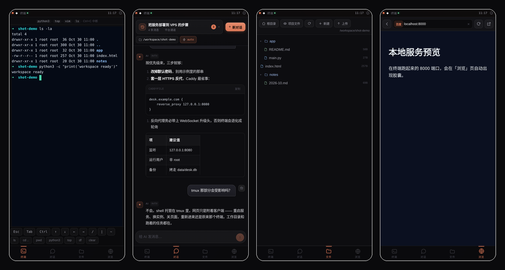

<div align="center">

# 云桌面 · Cloud Desk

**手机点开即用的 Linux 工作台** —— 真终端、AI 对话、文件管理、网页预览，都在一个页面里。

[](https://www.python.org/)
[](https://fastapi.tiangolo.com/)
[](#)
[](Dockerfile)
[](LICENSE)



</div>

---

## 这是什么

一台跑在浏览器里的 Linux 桌面。后端只有一份 `server.py`（FastAPI），前端是原生 HTML/JS，第三方资源（xterm.js、CodeMirror）全部本地化——**不需要构建，不需要 npm**。

它跑在谁的机器上，就吃谁的配置：没有绑定任何云平台，也没有账号体系，一个密码就是全部。

| 标签 | 你能做什么 |
|---|---|
| 💻 **终端** | 真 PTY，`cd` / 跑项目 / `Ctrl+C` / Tab 补全；会话托管在 tmux，关页面、重启服务都还在 |
| 💬 **对话** | 免 Key（复用本机 `codebuddy` CLI 登录态）或自带 OpenAI 兼容接口；多会话、真流式 |
| 📁 **文件** | 浏览 / 上传 / 新建 / 在线编辑（CodeMirror），按类型着色、显示大小 |
| 🌐 **浏览** | 终端跑起来的端口自动变胶囊，点开即内嵌预览；也可用服务端 Chromium 打开任意网站 |

## 为什么是「手机优先」

这个项目一开始就是为了**在手机上用**才写的，不是把桌面版缩一缩：

- 底部四标签、单列布局，拇指可达；桌面端才展开成侧栏
- PWA 可"添加到主屏幕"，全屏无地址栏，和原生 App 几乎没差别
- 登录态 30 天（记住我 180 天），终端会话常驻，**掏出手机就是连接状态**
- 手势：点画面即点击、上下滑即滚动、底部输入条负责键入与回车
- 桌面端同样能用，只是内容区限宽 1000px，不再铺满整屏

> 一句话：**移动优先，桌面兼容。** 手机是主场，电脑是顺带。

## 30 秒跑起来

### 本机直跑

```bash
git clone https://github.com/whs2007/cloud-desk.git && cd cloud-desk
pip install -r requirements.txt
python3 server.py
```

首次启动会生成随机密码并打印在终端，浏览器打开 <http://localhost:8080> 输入即可。
想自己指定：`DESK_PASSWORD=你的密码 python3 server.py`。

### Docker（推荐）

```bash
# 没有默认密码：不设置会直接启动失败，从机制上避免"照抄示例口令"
DESK_PASSWORD='换成你自己的强密码' docker compose up -d --build
```

需要内置截图浏览器（能打开任意网站）时，把 `docker-compose.yml` 里的
`WITH_BROWSER: "0"` 改成 `"1"`，首次构建会多花几分钟装 Chromium。

### 自己的服务器

```bash
git clone https://github.com/whs2007/cloud-desk.git && cd cloud-desk
pip install -r requirements.txt
DESK_PASSWORD='一个足够长的密码' python3 server.py
```

上线前**必须**做三件事——这个应用能在终端执行任意命令，等于把 shell 交出去了：

1. **改密码**，别用示例里的；
2. **套 HTTPS 反代**，Caddy 两行搞定：
   ```caddyfile
   desk.example.com {
       reverse_proxy 127.0.0.1:8080
   }
   ```
   Nginx 记得带 WebSocket 升级头，否则终端会退化成轮询：
   ```nginx
   proxy_set_header Upgrade $http_upgrade;
   proxy_set_header Connection "upgrade";
   ```
3. **绑回环 + 非 root 用户**：`server.py` 默认监听 `0.0.0.0`，走反代时改成 `127.0.0.1`，并用独立系统用户运行。

## 配置项

| 变量 | 默认 | 说明 |
|---|---|---|
| `PORT` | `8080` | 监听端口 |
| `DESK_PASSWORD` | 随机生成 | 访问密码，仅首次启动（无 `auth.json`）时生效 |
| `WORKSPACE_ROOT` | `/workspace` → `~/workspace` | 文件树与终端的工作区根目录 |
| `DESK_TMUX_SESSION` | `desk` | tmux 会话名，同名会话被所有访问端共享 |
| `DESK_CHAT_TOOLS` | 空（禁用） | 平台通道允许的工具，如 `Read,Glob,Grep`；留空 = 纯对话 |
| `DESK_PROXY_ALLOW_PRIVATE` | 空（禁止） | 设为 `1` 才允许 `/proxy` 访问内网。**仅纯内网部署时打开** |
| `BRIDGE_SECRET` | 自动生成 | 本地脚本写入对话记录的校验密钥（`data/bridge_secret`） |

## 功能细节

**终端**：shell 跑在 tmux 里，网页只是"附着客户端"。关页面、刷新、切后台、重启服务、换实例，重新进来还是原来那个终端——工作目录、命令历史、正在跑的任务都在。手机和电脑可以同时附着。没装 tmux 会自动退回裸 bash（功能正常，重启即丢）。终端默认落在 `WORKSPACE_ROOT`。

**对话**：两条通道，自动选。

- **平台通道（免 Key）**：机器上装了 `codebuddy` CLI 且登录过，就直接复用这份登录态；实现上只是把 CLI 当本地模型网关，`--session-id/--resume` 续上下文，没做任何逆向。
- **自有 API（BYO）**：任何兼容 OpenAI `/chat/completions` 的服务——OpenAI、DeepSeek、通义、智谱、Moonshot、one-api 都行。

安全默认：平台通道**禁用全部工具**（`--tools ""`），模型只能说话。想让它读工作区，设 `DESK_CHAT_TOOLS="Read,Glob,Grep"`。

**会话存储**：SQLite 单文件（`data/desk.db`，WAL）。两张表：`conversations`、`messages`。不用 jsonl 是因为要按会话过滤、并发写防撕裂、可排序；不引 Redis/Postgres 是因为单机工具多一个服务就多一个会坏的地方。备份 = 拷走这一个文件。

**浏览**：终端里 `python3 -m http.server 8000`，浏览页顶部会冒出 `8000` 胶囊，点开即内嵌。任意网址走服务端 Chromium 截图回传，点画面 = 点元素，上下滑 = 滚动页面。

## 安全设计

部署到公网前请读这段。

| 机制 | 说明 |
|---|---|
| 密码 | 18 位随机；PBKDF2-SHA256（12 万次迭代）加盐；文件权限 `600` |
| 登录限流 | 同 IP 5 分钟内失败 5 次锁 5 分钟 |
| 会话令牌 | 自签名 `过期时间.HMAC`，30 天；「记住我」180 天，**磁盘只存 SHA-256** |
| Bridge 密钥 | 每实例随机，`data/bridge_secret`（600），请求头校验 + 恒定时间比较 |
| SSRF 防护 | `/proxy` 先解析真实 IP 再按网段判定，拦 `127/8`、`10/8`、`172.16/12`、`192.168/16`、`169.254/16`、CGNAT、IPv6 本地/映射、`metadata.*`、`*.internal`；**不跟随重定向** |
| 路径穿越 | 所有文件接口 `resolve()` 后做前缀校验，越界直接拒 |

仍然要注意：

- 终端 = 真 shell，拿到密码的人就能执行任意命令；
- `/proxy` 的"解析后再请求"理论上仍有 DNS rebinding 窗口，安全要求极高时换固定出口白名单；
- 平台通道消耗的是**这台机器**的登录额度，公开分享前请切到自有 API。

## 架构

```
浏览器（原生 JS，零构建）
   │  WebSocket /ws/terminal        ← PTY，挂在 tmux 上
   │  HTTP  /api/*                  ← 文件 / 会话 / 设置
   ↓
server.py (FastAPI)  ── store.py (SQLite)  ── platform_chat.py (codebuddy CLI)
```

三个后端文件分工明确：`server.py` 只管路由与转发，存储细节在 `store.py`，模型通道在 `platform_chat.py`。换存储只改前者，换模型通道只改后者。

```
server.py              # 路由：认证 / PTY / 文件 API / 端口代理 / 截图浏览器
store.py               # 会话与消息的 SQLite 持久化
platform_chat.py       # 平台通道：把 codebuddy CLI 当本地模型网关
say.py                 # 小工具：让本地脚本把消息写进对话
static/
  index.html           # 单页骨架 + 交互逻辑
  app.css              # 设计系统：色板 / 组件 / 响应式
  manifest.json        # PWA
  vendor/              # xterm.js、CodeMirror（本地化，不走 CDN）
docs/screenshots/      # README 配图
data/                  # 会话库（gitignore）
```

## 常见问题

**打开一片空白？**
先看服务端日志。强制刷新（Ctrl/⌘+Shift+R）。若经网关访问，URL 必须带 `?sharecode=...`。

**终端一直转圈？**
反代没转发 WebSocket 升级头。补上 `Upgrade` / `Connection` 两行，或等它自动降级为轮询。

**忘记密码？**
删掉 `auth.json` 重启会重新生成并打印；或 `DESK_PASSWORD=新密码 python3 server.py`（需先删 `auth.json`）。

**文件树看不到我的项目？**
把 `WORKSPACE_ROOT` 指到项目所在目录。前端会自动跟随这个路径，不需要改代码。

**能接 WorkBuddy 的云端配置吗？**
WorkBuddy 给的是一台沙箱容器，不是一个可调用的配置服务，所以"填个地址接过来"不存在。正确路径是在会话里让 Agent 把项目跑起来，再发布成公网链接。

## 限制（实话）

- **没有 GPU**，别在容器里加载大模型；8 GB 内存是硬墙，容易 OOM
- 截图浏览器每页 0.5–2 秒延迟，重度 JS / 视频站点体验一般
- 单机单进程，没有多租户隔离；要多人用请各自部署

## 参与

Issue / PR 都欢迎。改动前端不需要构建步骤，改完刷新即可；后端就一个 `server.py`，改完重启。

仓库自带一份 CI 示例（`docs/ci.yml`）：语法检查 + 启动冒烟。想让它跑起来，复制到 `.github/workflows/ci.yml` 再提交即可（提交 workflow 文件要求 token 带 `workflow` 权限）。

## License

[MIT](LICENSE)
