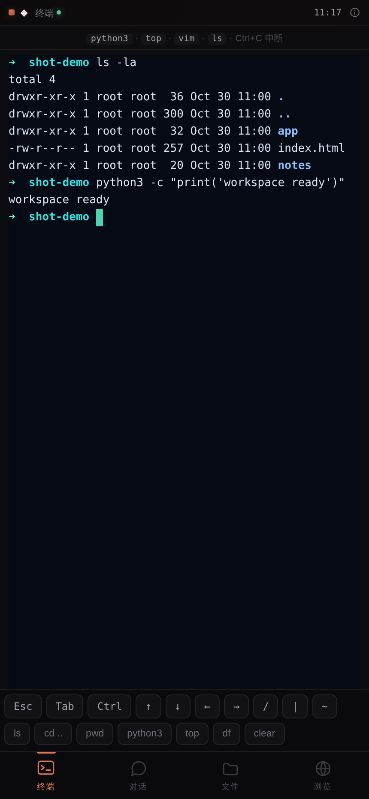
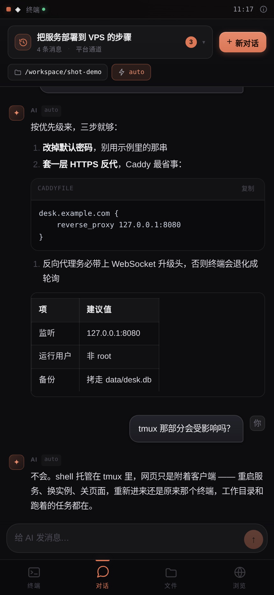
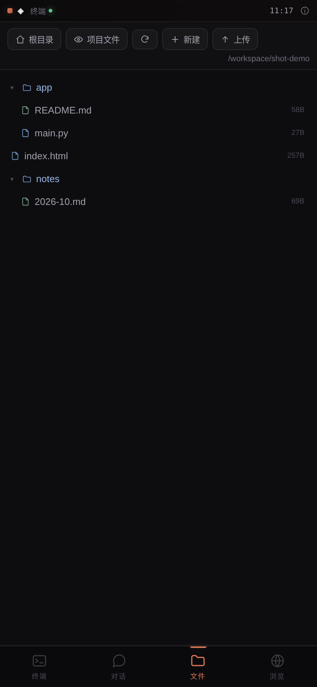
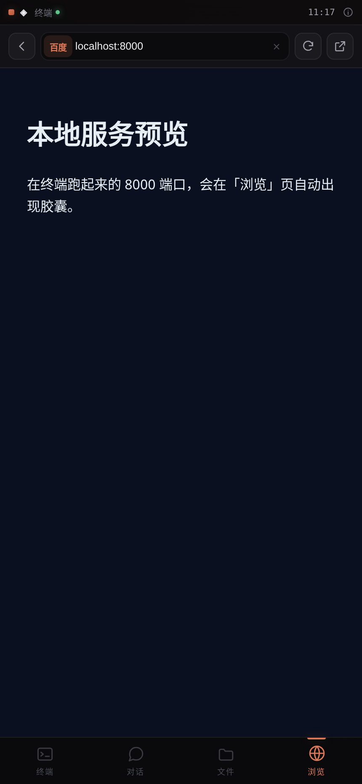

# 手机端使用指引

> 这份文档只讲一件事：**在手机上把它用起来、用顺手**。
> 部署、配置项、架构说明在 [README](../README.md)。

手机是这个项目的主场：底部四个标签、单列布局、拇指可达，装到主屏幕后和原生 App 差别不大。下面按"第一次打开 → 每个标签怎么用 → 踩坑怎么办"的顺序走。

---

## 一、第一次打开（大约三分钟）

### 1. 拿到两样东西

- **地址**：自己部署的域名，或托管平台给的链接（带 `?sharecode=...` 的那种，参数不能丢）。在 WorkBuddy 里把项目发布成应用后拿到的地址就属于后者
- **密码**：`DESK_PASSWORD` 设的那个；没设的话，首次启动时终端里会打印一串 18 位随机密码

### 2. 输密码

打开链接会看到登录框，勾上「**记住我**」再进入：

| 选项 | 有效期 | 什么时候用 |
|---|---|---|
| 勾选「记住我」 | 180 天 | 自己的手机，常用 |
| 不勾 | 30 天 | 借别人的手机、公共设备 |

同一 IP 5 分钟内错 5 次会锁 5 分钟——不是坏了，等一会儿再试。

### 3. 添加到主屏幕（强烈建议）

装到桌面后是全屏的，没有地址栏，返回手势也不会误退出。

| 系统 | 操作路径 |
|---|---|
| **iPhone / iPad** | 必须用 **Safari** 打开 → 底部「分享」按钮 → 向下滑找到「**添加到主屏幕**」→ 右上「添加」 |
| **Android** | Chrome 打开 → 右上「⋮」→「**添加到主屏幕**」/「安装应用」 |

几个前提：

- **微信、QQ、钉钉里打开是不行的**。内置浏览器会拦掉一部分功能，右上角「⋯」→「在浏览器打开」再操作。
- iPhone 上只有 Safari 能加到主屏幕，Chrome for iOS 加出来的是普通书签。
- 添加时的名字会自动取 `云桌面`，图标是深蓝底的那个。

> ⚠️ 如果地址带 `?sharecode=...`，Android 的「安装应用」有可能只按清单里的 `start_url` 启动、把参数丢掉，表现为打开白屏。遇到就改用**浏览器书签**（保留完整 URL），或者干脆部署到自己的域名。

---

## 二、界面长什么样

| 终端 | 对话 | 文件 | 浏览 |
|---|---|---|---|
|  |  |  |  |

底部四个标签，当前那个是橙色。三条通用规则：

1. **所有操作都在拇指区**，不需要够到屏幕顶部。
2. **键盘弹出时页面会压缩**，不会把输入框顶到看不见的地方。
3. 底部留了安全区，iPhone 的小白条不会压住标签栏。

---

## 三、💻 终端

### 点一下才开始打字

进页面后终端就绪，**点一下黑色区域**才算聚焦、才会弹键盘。打字直接进 shell，跟本地终端一样。

### 底部按键条（手机专属）

手机键盘没有 Esc、Tab、Ctrl、方向键，所以底部有一排补上：

| 按键 | 作用 |
|---|---|
| `Esc` | 退出 vim 插入模式、取消当前输入 |
| `Tab` | **补全**。`cd doc` + Tab → `cd docs/`；连按两次列出所有候选 |
| `Ctrl` | 点一下展开第二行组合键 |
| `↑` `↓` `←` `→` | 历史命令、行内移动、vim 里上下行 |
| `/` `|` `~` | 路径分隔、管道、家目录——手机键盘要翻两页才找得到 |

点 `Ctrl` 后展开的六个：

| 组合 | 效果 |
|---|---|
| `C` 中断 | 停掉正在跑的命令（`ping`、`tail -f`、跑飞的脚本） |
| `D` 退出 | 退出当前 shell / `python3` 交互模式 |
| `Z` 挂起 | 把当前任务丢到后台（`fg` 召回） |
| `L` 清屏 | 等同 `clear`，屏幕糊了按这个 |
| `U` 清行 | 一行命令打错了，一键清掉重打 |
| `R` 搜索 | 历史命令搜索，接着打字就过滤 |

第三行是常用命令，点一下等于把命令打进去（**不会自动回车**，可以先改参数）：`ls` / `cd ..` / `pwd` / `python3` / `top` / `df` / `clear`。

### 会话是常驻的

shell 跑在 tmux 里，网页只是一个"远程显示器"：

- 关掉页面、切到微信、锁屏、地铁里断网——**回来还是原来那个终端**，工作目录、历史命令、正在跑的任务都在
- 服务端重启、换机器重新部署，也一样
- 网络断了会自己重连（提示「连接断开，2 秒后重连…」），不用刷新

> 手机和电脑可以同时连着同一个会话，输入是共享的。两边同时打字会互相插字，别在电脑上跑长任务时用手机按 `Ctrl+C`。

### 手机上更顺手的几个动作

- **横屏**：终端变宽，`vim`、`top`、看日志舒服很多
- **双指放大**：字号是 13px 固定的，看不清就双指放大（放大后左右拖动看长行）
- **复制**：长按终端区域调出系统的选择/拷贝菜单
- **粘贴**：用键盘自带的「粘贴」；iOS 第一次会问"允许粘贴"，选允许

### 小提醒

- 没装 tmux 时页面会提示，终端退化成本机 bash：能用，但服务一重启现场就没了
- `vim` 在手机上只适合小改；改大文件建议用「文件」标签的编辑器，或者回电脑上弄

---

## 四、💬 对话

### 顶部：当前会话 + 历史

左上角那个**带时钟图标的长条按钮**就是历史入口，点开从底部升起「全部会话」抽屉：

- 中间显示当前会话标题，下面一行是消息数和通道名
- 右侧橙色数字是**历史会话总数**
- 抽屉里点任意一条切换；点右侧 `✕` 删除（会二次确认，删了不可恢复）
- 右上角「**+ 新对话**」随时开一个干净的

### 两个胶囊：工作区和模型

| 胶囊 | 点开能做什么 |
|---|---|
| 📁 工作区 | 给这个会话绑定一个目录，AI 后续操作、文件上下文都基于它 |
| ⚡ 模型 | 切换通道和模型 |

模型弹窗里两条通道：

| 通道 | 适合谁 | 说明 |
|---|---|---|
| **平台通道（免 Key）** | 机器上装了 `codebuddy` CLI 并登录过 | 复用这份登录态，不消耗你的 API Key |
| **自己的 API** | 想用自己的额度 | 填 `base_url`（如 `https://api.deepseek.com/v1`）、API Key、模型列表（逗号分隔），可以点「拉取模型列表」自动填。Key 留空 = 不修改已保存的 |

### 发消息

底部输入框，打一行会自动长高，右侧 `↑` 发送。回复是流式的，边生成边出，长回答不用干等。生成过程中右下角按钮会变成 **■**，点一下即可停止，已经生成的部分会保留；等待超过 2 分钟没有任何输出也会自己中止，不会一直转圈。

Markdown 会正常渲染：**粗体**、列表、`行内代码`、代码块（带横向滚动）、表格。

### 让它把项目跑起来（重点）

标题下面写着「平台通道 · **可执行**」时，它是真能手动的。直接说：

> 把这个项目拉下来跑起来：`https://github.com/xxx/yyy`

手机上你会依次看到：

| 阶段 | 屏幕上发生什么 |
|---|---|
| 动手 | AI 气泡上方滚动显示 `🔧 Bash …`，是它正在执行的命令 |
| 起服务 | 出现一张**绿色服务卡**：`服务已启动 :3000`，下面写着进程名和命令 |
| 打开 | 点卡上的「**在这里打开**」，全屏铺满预览，页面就是刚跑起来的项目 |
| 收起 | 左上角 `✕` 回到对话；`⟳` 重载；`↗` 用系统浏览器打开 |

卡上的三个按钮：

- **在这里打开** — 对话内全屏预览，最适合手机上快速确认
- **浏览标签** — 切到 🌐 浏览页，那边有地址栏和后退
- **停止** — 直接杀掉这个服务（会二次确认，不会误停系统端口）

顶栏还会多一个绿色的 `● N` 胶囊，是**所有在跑的服务**的汇总入口：点开列表，逐条打开或停止。关掉对话再回来，卡片没了，但这个胶囊一直在——服务在 tmux 里活着。

> **第一次会比较慢。** 克隆 + 装依赖可能要几分钟，期间 `🔧` 一直在动就说明它在干活。如果 `git clone` 一直超时，它会自己换镜像（jsdelivr / zip 包）。真跑不起来，它会写 `⚠️ FAILED: 原因`，并给一条能直接粘到终端跑的命令。
>
> **它默认能执行命令**（`DESK_CHAT_TOOLS` 含 `Bash`）。不想要这个能力，让部署方设成 `Read,Glob,Grep`（只读）或留空（纯聊天），标题下面会相应变成「· 可读文件」/「· 仅对话」。

---

## 五、📁 文件

### 顶部工具条

| 按钮 | 作用 |
|---|---|
| 🏠 根目录 | 不管当前在哪，一键回到工作区根 |
| 👁 项目文件 | 在「工作区」和「项目源码」之间切换（默认隐藏项目本体，避免误改） |
| ↻ 刷新 | 在终端里新建/删除了文件，点一下同步 |
| + 新建 | 在当前目录建空文件 |
| ↑ 上传 | 调系统文件选择器 |

右上角灰字是当前路径，路径太长会自动省略中间。

### 打开和编辑

- 点文件夹进入，左上角「根目录」回退（没有单独的返回键，路径就是导航）
- 点文件直接在页面内打开编辑器（CodeMirror，带语法高亮）
- 改完点「**保存**」，点「关闭」回列表
- 文件名按类型着色，右侧显示大小，扫一眼就知道哪个是日志、哪个是配置

### 上传

点「上传」会调起系统的文件选择器：

- **iPhone**：从「文件」App 里选。iCloud 云盘、第三方网盘的文件要先在「文件」里下载到本机才能选
- **Android**：文件管理器 / 相册 / 下载，按系统弹窗走

大文件（几十 MB 以上）在手机上容易中断，建议用终端 `scp` / `curl` 传。

### 你大概看不到的几个文件

`auth.json`、`remember.json`、`chat_config.json`、`data/` 这些默认不显示——它们存密码哈希、登录令牌和会话库，手机上误点误改会把登录搞坏。需要的话在终端里看。

---

## 六、🌐 浏览

这个标签是"在手机里再看一个浏览器"，两种模式自动切换。

### 地址栏

从左到右五件事：`‹` 后退 · 搜索引擎（点一下换百度/必应/Google）· 输入框 · `↻` 刷新 · `↗` 用系统浏览器打开。

输入框认三种写法：

| 你输入 | 会发生什么 |
|---|---|
| `8000`（纯数字） | 当作端口，直接打开本机 `localhost:8000` |
| `example.com` / `example.com/path` | 补上 `https://` 当网址打开 |
| `fastapi 部署` | 当搜索词，用当前引擎搜 |

### 端口胶囊

在终端里起了服务（`python3 -m http.server 8000`、`npm run dev`、`uvicorn ...`），顶部会自动冒出 `8000` 这样的胶囊，**点一下直接看**，不用手打地址。端口关掉了胶囊也会消失。**对话里让 AI 起的服务也在这里**——不管是终端还是对话起的，只要在监听就认得出来。宿主自带的一堆系统端口已经过滤掉了，不会来捣乱。

### 两种模式，别搞混

| 情况 | 模式 | 体验 |
|---|---|---|
| 本机端口（胶囊 / 输入纯数字） | 内嵌 iframe | 快，真的能点、能输入、能滚动，和你电脑上打开一样 |
| 任意外部网站 | 服务端截图 | 慢 0.5–2 秒，但能绕过跨域和部分登录墙 |

截图模式下：

- **点画面 = 点网页元素**（点输入框会聚焦）
- **上下滑 = 滚动页面**
- 底部有输入条：打完字点「**键入**」只输入不提交，点「**↵**」输入并回车（搜索框、登录框用它）
- 页面是图片，所以**文字选不中也复制不了**——要复制内容就点 `↗` 用系统浏览器打开

### 什么时候该点 `↗`

视频、需要下载的文件、要登录账号的网站、要装 App 的页面——一律外开。内置的截图模式只适合"看一眼对不对"。

---

## 七、手机上容易踩的坑

**微信里打开一片白？**
内置浏览器拦截。点右上角「⋯」→「在浏览器打开」，或者复制链接到 Safari / Chrome。

**点终端没反应、不弹键盘？**
先点一下黑色区域（不是点标签，是点终端画面）。如果还是不弹，点一下底部按键条任意键，能强制唤起。

**键盘挡住了输入框？**
页面会随键盘压缩，正常不会挡。如果卡住了，收起键盘再点一次输入框。

**终端一直显示「连接断开，2 秒后重连」？**
九成是反向代理没转发 WebSocket 升级头。看 README 的 Nginx 那两行 `Upgrade` / `Connection`。另外公司网络/机场可能掐长连接。

**加到主屏幕后打开白屏？**
多半是 `?sharecode=...` 被丢掉（见第一节末尾）。改用带完整参数的浏览器书签。

**密码明明对，提示错误？**
检查是不是被锁了（5 分钟内错 5 次）。还不行就让服务端删掉 `auth.json` 重启，会重新生成密码并打印。

**文件页看不到我的项目？**
`WORKSPACE_ROOT` 没指对。改成项目所在目录重启，前端会自动跟随。

**服务卡点开是文件列表 / 一片白？**
多半是服务起在了 `/workspace` 而不是项目目录里（于是 `/` 是这个大目录的列表）。回一句「在这个项目目录里重新起一遍」即可，它会用 `tmux ... -c <项目目录>` 重开。白屏则是依赖还没装完，看对话里的 `🔧` 是否还在动。

**页面出来了但点按钮没反应、样式缺一块？**
反代改得了 HTML 里的路径，改不了 JS 里拼出来的接口地址，也不转发 WebSocket。热更新、实时协作这类功能会失效，点 `⟳` 刷新或 `↗` 外开。这是 `/preview` 反代的已知边界，不是服务没起来。

**网页很糊、字发虚？**
截图是按屏幕宽度生成的，双指放大会糊。要看清就外开。

**锁屏回来变成黑屏/空白？**
等 2 秒自动重连；不行就下拉刷新。tmux 里的任务不会丢。

---

## 八、手机上更要紧的安全习惯

手机容易丢，而这个页面等于一台能执行任意命令的机器。

| 场景 | 怎么做 |
|---|---|
| 手机丢了 / 借人用过 | 删掉服务端的 `data/session_secret` 和 `remember.json`，重启 → 所有设备立刻掉线 |
| 怀疑密码泄露 | 再删掉 `auth.json` 重启，会重新生成密码并打印；或 `DESK_PASSWORD='新密码'` 配合删除 `auth.json` |
| 连公共 WiFi | 一定要 HTTPS（Caddy 两行就够），否则密码和终端内容都是明文 |
| 不想留痕 | 登录时不勾「记住我」，用完点浏览器「清除网站数据」 |

平台通道消耗的是**这台机器**的登录额度，别把带平台通道的链接发给别人。

---

## 一句话版本

> 密码进去 → 加到主屏幕 → 终端点一下就能打字，`Ctrl` 在底部按键条里 → 跑起来的端口在「浏览」里点胶囊就能看 → 关掉页面什么都不丢。
